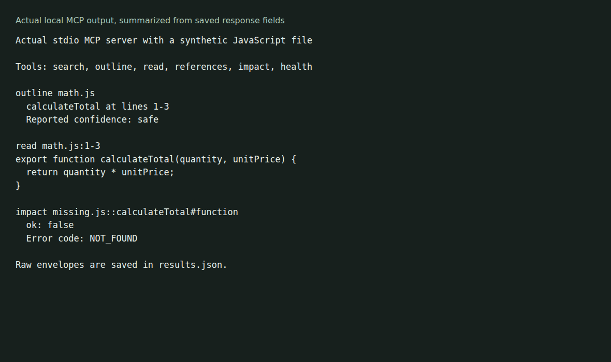

# Symslice

Symslice is a local MCP server that gives coding agents just the code they ask for. It indexes your repository, and when an agent needs a function, class or method, Symslice returns that symbol's source instead of a whole file or a page of grep output. The agent keeps more of its context for the actual task.

It also searches and outlines symbols, and lists the code that may depend on a symbol, with every answer labelled by how it was found. Everything runs on your machine: no network calls, no model API, and the index lives outside your repository.



## Install

macOS and Linux, one line:

```sh
curl -fsSL https://github.com/olegpustovit/symslice-mcp/releases/latest/download/install.sh | sh
```

The installer picks the right build for your system (Linux x86_64/arm64, macOS Intel/Apple Silicon), checks its SHA-256 checksum and installs `symslice-mcp` into `~/.local/bin`. No Rust needed. On Windows, run it inside [WSL](https://learn.microsoft.com/windows/wsl/install).

## Get started in four steps

**1. Install** with the command above.

**2. Check that your shell finds it.** If `symslice-mcp --version` says "command not found", add `~/.local/bin` to your PATH and open a new terminal:

```sh
echo 'export PATH="$HOME/.local/bin:$PATH"' >> ~/.zshrc   # or ~/.bashrc
symslice-mcp --version
```

**3. Index your repository** once. This makes the first request fast; while the server runs it refreshes the index as files change:

```sh
cd /path/to/your/repo
symslice-mcp ingest .
```

**4. Connect your coding agent.** The easiest way is agentpack, which sets Symslice up for every agent at once. Or pick your agent below.

### With agentpack (all agents at once)

[agentpack](https://github.com/olegpustovit/agentpack) pins skills, plugins and MCP servers for coding agents in one project file. Install it:

```sh
curl --proto '=https' --tlsv1.2 -LsSf https://github.com/olegpustovit/agentpack/releases/latest/download/agentpack-installer.sh | sh
```

Then, in your repository, add the Symslice plugin and start your agent through agentpack:

```sh
agentpack init        # only if the repository has no agentpack.toml yet
agentpack add olegpustovit/symslice-mcp/plugins/symslice-mcp
agentpack claude      # or: agentpack codex, agentpack opencode, agentpack agent (Cursor), agentpack grok, agentpack agy
```

The plugin registers the Symslice server for Claude Code, Codex, Cursor, OpenCode, Grok and Antigravity, and adds a short rule that tells the agent when to use it. For Claude Code there is also an optional hooks plugin that nudges the agent from Grep/Glob to Symslice: `agentpack add olegpustovit/symslice-mcp/plugins/symslice-hooks`.

### Claude Code

Run in your repository:

```sh
claude mcp add --transport stdio --scope local symslice -- "$HOME/.local/bin/symslice-mcp" serve --workspace "$PWD"
```

Restart Claude Code and check `/mcp`.

### Codex

Run in your repository:

```sh
codex mcp add symslice -- "$HOME/.local/bin/symslice-mcp" serve --workspace "$PWD"
```

Restart Codex and check `codex mcp list`.

### Cursor

Create `.cursor/mcp.json` in your repository, with your own home directory in the path:

```json
{
  "mcpServers": {
    "symslice": {
      "command": "/Users/you/.local/bin/symslice-mcp",
      "args": ["serve", "--workspace", "${workspaceFolder}"]
    }
  }
}
```

Restart Cursor and check the server under MCP settings.

### OpenCode

Add to `opencode.json` in your repository:

```json
{
  "mcp": {
    "symslice": {
      "type": "local",
      "command": ["/Users/you/.local/bin/symslice-mcp", "serve"],
      "enabled": true
    }
  }
}
```

### VS Code (GitHub Copilot)

Create `.vscode/mcp.json` in your repository:

```json
{
  "servers": {
    "symslice": {
      "type": "stdio",
      "command": "/Users/you/.local/bin/symslice-mcp",
      "args": ["serve", "--workspace", "${workspaceFolder}"]
    }
  }
}
```

### Gemini CLI

Add to `.gemini/settings.json` in your repository:

```json
{
  "mcpServers": {
    "symslice": {
      "command": "/Users/you/.local/bin/symslice-mcp",
      "args": ["serve"]
    }
  }
}
```

Any other MCP client works the same way: launch `symslice-mcp serve --workspace /path/to/repo` over stdio. Use the full path to the binary in JSON configs, because editors started from the dock or start menu may not see your shell's PATH (the installer prints it).

## Try it

Ask your agent something like "Use symslice to outline `src/main.rs`, then read the `main` function." It calls Symslice's tools:

| Tool | What it returns |
|---|---|
| `search` | Symbols matching a name or description |
| `outline` | The symbols in a file or directory |
| `read` | The source of just the requested symbols |
| `references` | Places that refer to a symbol |
| `impact` | Files that may depend on a symbol, with how each was found |
| `health` | The state of the server and its index |

Each answer carries a confidence label (`safe`, `partial`, `heuristic` or `unreliable`). Dependency lists come from names and imports, so treat a missing entry as unknown, not as proof that nothing depends on the symbol. See the [limitations](docs/reference.md#limitations).

## Update or uninstall

Run the install command again to update to the latest release, then restart your agent. To install a specific version: `curl -fsSL https://github.com/olegpustovit/symslice-mcp/releases/latest/download/install.sh | sh -s -- v0.2.0`. To uninstall, delete `~/.local/bin/symslice-mcp` and the index folder (`~/.local/share/symslice-mcp` on Linux, `~/Library/Application Support/symslice-mcp` on macOS).

## More

- [Installation and tool reference](docs/reference.md): manual downloads, platform details, all options and environment variables.
- [Build from source](docs/reference.md#build-from-source) with a stable Rust toolchain.
- The [SANER 2027 Tool Demo paper](docs/reference.md#paper-and-reproduction-package) evaluated an earlier revision, `5d0f620`; later changes have not been reevaluated in that study.

[Architecture](ARCHITECTURE.md) · [Contributing](CONTRIBUTING.md) · [Apache-2.0 license](LICENSE) · [Third-party notices](NOTICE)
